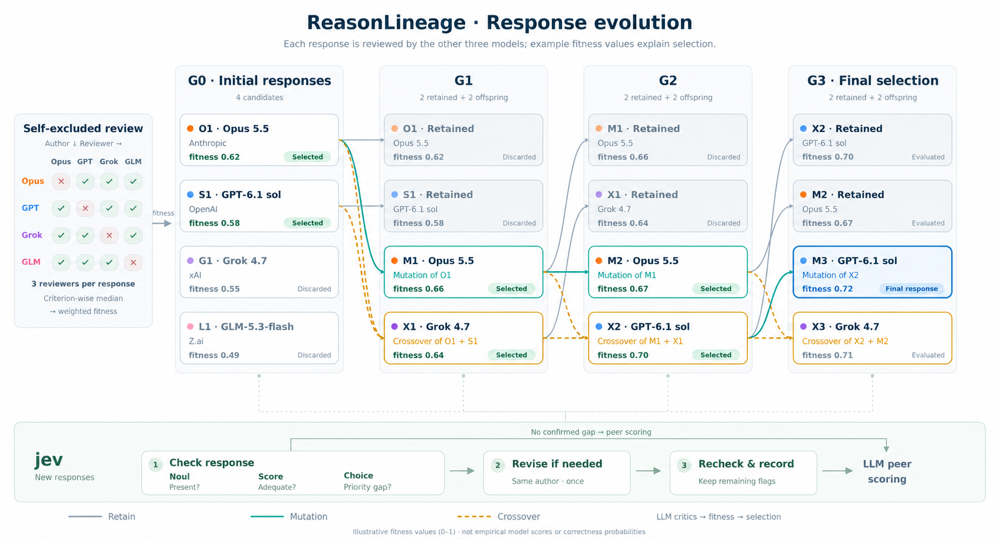

# ReasonLineage

> **An evolutionary reasoning engine with author-recused, context-isolated LLM judging.**

ReasonLineage improves responses through repeated generation, critique, selection, mutation, and crossover. It preserves the ancestry of each response and separates structural checks from the LLM reviews used to calculate fitness. The same process can be applied to answers, analyses, designs, and scientific hypotheses.

---

## Table of Contents

1. [Overview — what ReasonLineage does](#1-overview--what-reasonlineage-does)
2. [Evolution — non-author review and selection](#2-evolution--non-author-review-and-selection)
3. [jev — check, optionally revise, recheck](#3-jev--check-optionally-revise-recheck)
4. [Architecture](#4-architecture)
5. [Quick Start](#5-quick-start)
6. [Usage in Detail](#6-usage-in-detail)
   - [6.1 Start a run](#61-start-a-run)
   - [6.2 Resume a run](#62-resume-a-run)
   - [6.3 Diagnose a finished run](#63-diagnose-a-finished-run)
   - [6.4 Score runs against a gold file](#64-score-runs-against-a-gold-file)
   - [6.5 Scripts](#65-scripts)
7. [Environment variables and credentials](#7-environment-variables-and-credentials)
8. [Testing](#8-testing)
9. [License](#9-license)

---

## 1. Overview — what ReasonLineage does

| Capability | What it does |
|---|---|
| **Response evolution** | A panel of models writes responses. Survivors are kept, and new responses come from mutation and crossover. Every response keeps its parent links. |
| **Non-author fitness** | Models other than the author review each response. Reviews are aggregated by the median for each criterion and combined using the task's weights. |
| **jev structural checks** | Noul, Score, and Choice assessments check each new response before peer scoring. A confirmed gap can trigger one revision by the original author. jev values do not enter fitness. |
| **Recorded runs** | Model calls, events, and checks are written to a run folder, so a stopped run can be resumed and a finished run replayed, diagnosed, or scored against a gold file. |

Entry points:

- **CLI**: `reasonlineage run | resume | diagnose | gold` (also `python -m reasonlineage`)
- **Scripts**: judge calibration and backend checks in [`scripts/`](scripts)
- **Workflow**: the [detailed workflow](SKILL.md), written as an agent skill



The figure illustrates a four-model configuration: **Opus 5.5 (Anthropic), GPT-6.1 sol (OpenAI), Grok 4.7 (xAI), and GLM-5.3-flash (Z.ai)**. Model availability and the active reviewer panel are set by the setup file. All displayed fitness values are illustrative.

---

## 2. Evolution — non-author review and selection

### 2.1 The problem: models judging their own work

The engine was built to test one question. When a model scores its own answers, or judges share the scoring record, does fitness keep rising across generations while correctness stays flat? And does removing the author from scoring, and judging each response in isolation, prevent it? To compare those conditions fairly, the code fixes who writes, who judges, and what is checked, so every condition runs the same procedure.

### 2.2 How ReasonLineage handles it

1. With N active models, each writes ⌈4 / N⌉ initial responses, so the population holds P = N × ⌈4 / N⌉ responses (two each with three models, one each with four). Every active model except the author reviews each response; with a single model, it reviews its own responses in separate, fresh calls.
2. Reviews are aggregated by the median for each criterion and combined using the task's weights to obtain fitness.
3. P − 2 responses survive selection. Retained responses reuse their scores.
4. Each later generation adds one mutation, written by the parent response's author, and one crossover, written by a model that authored neither parent. If every active model wrote one of the parents, one of them writes the crossover and the run records a `synthesizer_fallback` anomaly.
5. New responses are checked and reviewed before the next selection. The best evaluated response is returned with its lineage.

Survivors are **responses**; keeping P − 2 of them does not shrink the roster, and every active model keeps writing and reviewing.

### 2.3 Key design decision: code decides, models write and judge

| The engine (code) decides | The models do |
|---|---|
| who judges each response, and what the judge sees | write responses: initial, mutation, crossover |
| fitness: the per-criterion median, then the weighted sum | review and critique |
| selection and the generation count | choose which parts of each parent a crossover drops |
| records, protocol version, and mode checks | |

Two run options vary the judging, for experiments on judging bias. The defaults are `recuse` and `isolated`.

| `--judges` | Who scores a response |
|---|---|
| `recuse` | every panel model except the author (a one-model panel judges its own responses, each in a fresh session) |
| `self` | the author only |
| `same_family` | other panel models from the author's company |
| `other_vendor` | panel models from other companies |
| `all` | every panel model, the author included |

| `--context` | What the judge sees besides the question and the response |
|---|---|
| `isolated` | nothing else |
| `author_label` | the name of the author model |
| `shared_trace` | the current population, with scores from earlier selections |

---

## 3. jev — check, optionally revise, recheck

### 3.1 The problem: fitness does not check structure

Peer fitness and structural completeness measure different things. A response can be complete in form and still cite papers that do not support it. An interesting idea can lack the validation strategy that would make it a comparable research proposal. The J1 gate targets the second kind of gap: it decides when to send a response back and what to fix.

### 3.2 How the gate works

The combined jev gate uses three parallel typed assessments:

| Type | Short label | Role |
|---|---|---|
| Noul | Present? | Check whether the required response or proposal is present. |
| Score | Adequate? | Check whether required components are sufficiently developed. |
| Choice | Priority gap? | Identify the component that most needs attention. |

Confirmed gaps can trigger **one revision by the original author**, followed by reinspection. Responses without confirmed gaps proceed directly to peer scoring. Unclear judgments can be rechecked once, and unresolved issues are recorded.

In the combined profile, Score's adequacy threshold is applied to **P(level 2) + P(level 3) < 0.5**. Choice selects the highest-probability priority gap, and a targeted revision requires agreement with the insufficient component scores.

### 3.3 Key design decision: jev checks, reviewers score

The structural gate does not directly add jev values to fitness; fitness remains the responsibility of the LLM reviewers. J2 diagnostics are recorded separately and do not drive survival or revision. In the code, checker results go to the run's `checks.jsonl`, never to the engine's event log, and J1's revision decision is the only way a check affects the run.

The rules above belong to the combined profile, [`src/reasonlineage/protocol/profiles/jev-combined`](src/reasonlineage/protocol/profiles/jev-combined), which sets `j1.enforce` to `true`; select it with `reasonlineage run TASK --protocol jev-combined`. The default protocol that `reasonlineage run` loads, [`src/reasonlineage/protocol/protocol.json`](src/reasonlineage/protocol/protocol.json), has its own question set and sets `j1.enforce` to `false`: the gate records what it would revise without requesting the revision.

### 3.4 Evolution in motion


[Interactive animation](assets/figures/reasonlineage-jev-simple-types/animation.html) · [MP4](assets/figures/reasonlineage-jev-simple-types/animation.mp4) · [SVG](assets/figures/reasonlineage-jev-simple-types/overview.svg) · [High-resolution PNG](assets/figures/reasonlineage-jev-simple-types/overview-native.png) · [Figure caption and production notes](assets/figures/reasonlineage-jev-simple-types/README.md)

Download the HTML animation and open it locally to use its playback controls; GitHub displays its source. The animation is 28 seconds long and demonstrates both the optional revision path and the direct path to peer scoring.

---

## 4. Architecture

```
task (*.json)  +  setup (configs/main.json)  +  protocol (default or --protocol profile)
                                     │
                                     ▼
cli.py                  checks pinned versions and the judging condition, writes header.json
                                     │
                                     ▼
engine/runner.py        generation 0 → J1 gate → non-author review → selection
                        → mutation + crossover → … → result.json
   ├── backends/        claude · codex · grok CLIs, OpenAI-compatible HTTP
   ├── checks/gate.py   J1: jev or a local LLM checker → checks.jsonl
   └── core/            fitness, selection, roles
                                     │
                                     ▼
run folder              header.json · events.jsonl · calls/ · checks.jsonl · result.json
   ├── resume           continues from the recorded calls
   ├── diagnose         J2 and PMID check → diagnostics/
   └── gold             gold scoring → diagnostics/gold.jsonl, summary
```

| Component | Location |
|---|---|
| Command line (`run`, `resume`, `diagnose`, `gold`) | `src/reasonlineage/cli.py` |
| Run loop, policies, call recording and replay, event log, run header, judging conditions, setup and task loading | `src/reasonlineage/engine/` |
| Fitness, selection, roles, category weights, population state | `src/reasonlineage/core/` |
| Model backends: `claude`, `codex`, `grok` CLIs and OpenAI-compatible `http` | `src/reasonlineage/backends/` |
| J1 gate, jev client, local LLM checker, combined jev rules | `src/reasonlineage/checks/` |
| J2 diagnostics, PMID check, gold scoring | `src/reasonlineage/diagnose/` |
| Packaged protocol (generations, timeouts, token caps, J1/J2 questions), prompts, and selectable profiles (`profiles/`) | [`src/reasonlineage/protocol/`](src/reasonlineage/protocol) |
| Default setup and example task | [`configs/main.json`](configs/main.json), [`examples/example-ipf.json`](examples/example-ipf.json) |

---

## 5. Quick Start

### 5.1 Prerequisites

- Python 3.11 or later. The core package has no runtime Python dependencies.
- For live runs, only the backends your setup uses:
  - `claude`: the Claude Code CLI, logged in with a subscription
  - `codex`: the Codex CLI, logged in with ChatGPT
  - `grok`: the grok CLI, logged in (`grok login`)
  - `http`: an OpenAI-compatible endpoint, and a key file if it needs a key
- For the jev checker: a jev API key ([§7](#7-environment-variables-and-credentials)).

### 5.2 Install and run the offline checks

```bash
python -m pip install -e '.[dev]'
reasonlineage --help
python -m pytest -q
```

Tests exclude live model/service calls by default.

### 5.3 Choose a setup

A setup file names the panel and the checkers. The default is [`configs/main.json`](configs/main.json):

| File | Panel | Checker for public / private tasks |
|---|---|---|
| `configs/main.json` (default) | opus, gpt, grok, glm (`glm-5.3`) | jev / a local DeepSeek endpoint |

A three-model setup with jev for public tasks looks like this:

```json
{
  "panel": [
    {"name": "gpt", "backend": "codex", "model": "gpt-6.1-sol", "effort": "xhigh"},
    {"name": "grok", "backend": "grok", "model": "grok-4.7", "effort": "xhigh"},
    {"name": "glm", "backend": "http", "model": "glm-5.3-flash", "effort": "max",
     "base_url": "https://ollama.com/v1", "family": "zai", "api_key_file": "~/.config/reasonlineage/ollama.env"}
  ],
  "checkers": {
    "jev": {"version": "jev-1.13.0", "api_key_env": "JEV_API_KEY", "api_key_file": "~/.config/reasonlineage/jev.env"}
  },
  "checker_for": {"public": "jev"},
  "concurrency_per_backend": 2
}
```

- `backend` is `claude`, `codex`, `grok`, or `http`. An `http` member also needs `base_url` and `family` (the company that made the model).
- `checker_for` maps `public` and `private` tasks to `jev` or to a local checker listed under `checkers`. jev is an outside service, and the loader rejects a setup that sends private tasks to it.
- Experiment mode refuses model names containing `latest` or `preview`. Pin versions.

### 5.4 Write a task

[`examples/example-ipf.json`](examples/example-ipf.json):

```json
{
  "id": "ipf-example",
  "question": "Which approved drug is most promising to repurpose for idiopathic pulmonary fibrosis (IPF)? Rank the candidates, and give the mechanism, the key evidence, and a validation experiment for the top pick.",
  "candidates": ["metformin", "imatinib", "sildenafil"],
  "category": "biomedical",
  "data_sensitivity": "public"
}
```

| Field | Required | Meaning |
|---|---|---|
| `id`, `question` | yes | non-empty strings |
| `candidates` | no | at least two distinct items to rank |
| `category` | no (default `biomedical`) | picks the fitness weights: `general`, `math`, `science`, `creative`, `ethical`, `coding`, `analytical`, `biomedical` |
| `data_sensitivity` | yes | `public` or `private`; picks the checker through `checker_for` |

Leave out `candidates` for an open question, the kind of task the `jev-combined` profile checks.

Then start a run as shown in [§6.1](#61-start-a-run).

---

## 6. Usage in Detail

### 6.1 Start a run

```bash
# Defaults: configs/main.json, experiment mode, recuse + isolated, generations from protocol.json (3)
# Calls the models in the setup; ends with a "Done:" line naming the run folder under runs/ (ignored by Git)
reasonlineage run examples/example-ipf.json

# A fixed seed and another output folder
reasonlineage run examples/example-ipf.json --seed 1 --out runs/demo

# Generation 0 only
reasonlineage run examples/example-ipf.json --generations 0 --seed 1

# The combined jev profile (§3) for an open question with an embedded evidence packet; needs a jev checker
# (see src/reasonlineage/protocol/profiles/jev-combined/README.md)
reasonlineage run my-question.json --protocol jev-combined

# Judge the generation 0 of an earlier run under another condition
reasonlineage run TASK --gen0-from runs/RUN_FOLDER --judges self --context isolated

# Reuse every answer an earlier run recorded, with its seed and conditions
reasonlineage run TASK --replay runs/RUN_FOLDER --generations 3
```

| Option | Default | Meaning |
|---|---|---|
| `--config` | `configs/main.json` | setup file with the panel and checkers |
| `--protocol` | `default` | `default`, a packaged profile (`jev-combined`), or a folder with `protocol.json` and `prompts/`; recorded in `header.json` and reused by `resume` and `diagnose` |
| `--mode` | `experiment` | `experiment` will not start unless model and jev versions are pinned, the generation count is fixed, the panel can serve the judging condition, and a checker exists when the protocol turns the J1 gate on. `exploration` checks only the judging condition. |
| `--judges`, `--context` | `recuse`, `isolated` | the judging condition ([§2.3](#23-key-design-decision-code-decides-models-write-and-judge)) |
| `--generations` | `protocol.json` (3) | with `--replay`, the replayed run's count |
| `--seed` | random | recorded in `header.json` |
| `--replay RUN_DIR` | | reuse every recorded answer, with that run's seed, conditions and protocol; refused if the protocol files differ |
| `--gen0-from RUN_DIR` | | reuse generation 0 of a run of the same task and protocol |
| `--out` | `runs` | folder for run folders |

A run folder holds:

| Path | Contents |
|---|---|
| `header.json` | task, setup, options, protocol version, hash and source, CLI versions, engine commit |
| `events.jsonl` | the engine's event log |
| `calls/` | one record per model call, reused by `resume` and `--replay` |
| `checks.jsonl` | J1 checker results, when a checker runs |
| `unusable/` | outputs that could not be used, per attempt |
| `result.json` | the final summary, written when the run finishes |
| `diagnostics/` | `j2.jsonl` and `pmid.jsonl` from `diagnose`, `gold.jsonl` from `gold` |

Exit codes for `run` and `resume`: `0` done, `1` cannot start or continue, `2` stopped (fix the cause, then resume), `143` interrupted by SIGTERM or SIGHUP (resume).

### 6.2 Resume a run

```bash
reasonlineage resume runs/RUN_FOLDER
```

`resume` rebuilds the run from `header.json` and the recorded calls. It reloads the protocol recorded in `header.json` and stops if those files changed since the run started, and it warns if a CLI version changed.

### 6.3 Diagnose a finished run

```bash
# J2 diagnostics and the PMID check (both call outside services)
reasonlineage diagnose runs/RUN_FOLDER

# Also ask J2 whether each answer reports a clinical-trial outcome for the listed items
reasonlineage diagnose runs/RUN_FOLDER --gold-items items.json   # {"items": [{"item": ..., "outcome_date": "YYYY-MM-DD"}]}
```

- **J2** runs the task's checker over the run and writes `diagnostics/j2.jsonl`. It is skipped when no checker is available.
- **PMID check** looks up each cited PMID in PubMed and checks that the record names the item it supports. It writes `diagnostics/pmid.jsonl`.

### 6.4 Score runs against a gold file

```bash
reasonlineage gold --gold my-gold.json runs/RUN_A runs/RUN_B \
  --out report.json --analysis analysis.md
```

`gold` makes no model calls. It prints a summary, writes `diagnostics/gold.jsonl` in each run folder, and, with `--out` and `--analysis`, saves the summary as JSON and the level-1 analysis as Markdown. The gold file has the form `{"tasks": {task id: {"approved": [...], "failed": [...]}}}`. A folder that is not a run, whose task is not in the gold file, whose candidates differ from the gold drugs, or whose run did not finish is left out with a warning.

### 6.5 Scripts

| Script | What it does | Calls models |
|---|---|---|
| `scripts/make_candidates.py` | every roster model writes one strong and one deliberately flawed answer to the same question, for judge calibration | yes |
| `scripts/calibrate_judges.py` | every judge scores every candidate `--repeats` times in isolated calls; reports leniency, noise, and recusal bias | yes |
| `scripts/calibrate_panel.py` | every roster judge scores every candidate, its own included; reports leniency and self- and family preference | yes |
| `scripts/check_backends.py` | one isolated scoring call per backend/model; reports context size and latency | yes |
| `scripts/smoke_claude_cli.py` | repeats a Strict Evaluator request concurrently through the Claude CLI; reports latency and score noise | yes |

The first line of each file says what it does.

---

## 7. Environment variables and credentials

| Variable | Read by | Purpose |
|---|---|---|
| `JEV_API_KEY` | `reasonlineage run`, `resume`, `diagnose`, when the task's checker is jev | The jev API key. The name is the default of `checkers.jev.api_key_env` in a setup. When the variable is unset, the CLI reads the file in `checkers.jev.api_key_file`. |

No other environment variable is read. Other credentials live in files:

- **`api_key_file`** on an `http` panel member or local checker: a file outside the repo that holds only the key. The program reads it and never prints it. An `http` member without one sends a placeholder key.
- **CLI logins**: the `claude`, `codex`, and `grok` backends use each CLI's own login. The grok backend runs with a temporary home that holds only the grok login, so no user configuration loads.

---

## 8. Testing

```bash
# Offline suite; tests marked `live` are deselected by default
python -m pytest -q

# A single file
python -m pytest -q tests/test_cli.py

# Live tests only: these call real models or services
python -m pytest -q -m live
```

`pyproject.toml` registers the `live` marker and sets `addopts = "-m 'not live'"`.

---

## 9. License

MIT — see [LICENSE](LICENSE).
