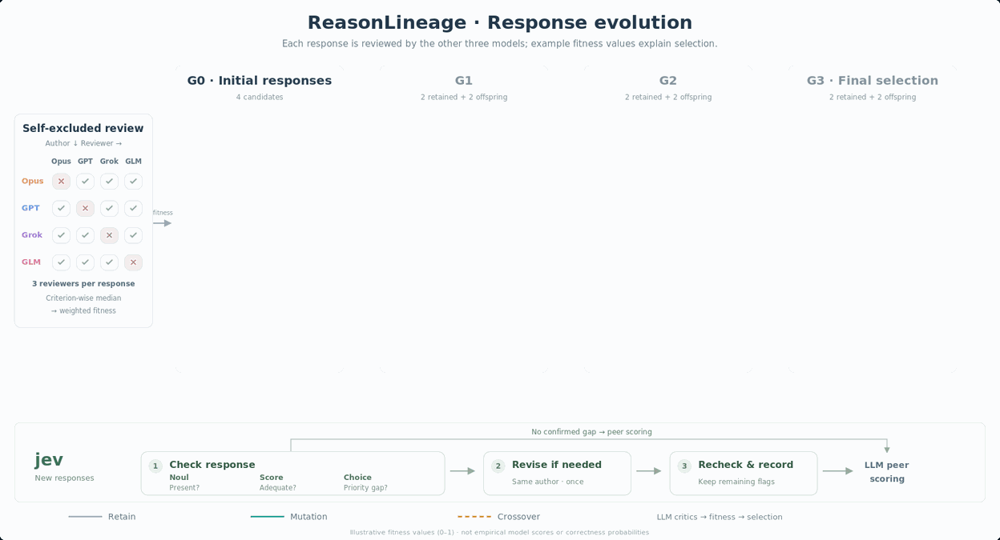

# ReasonLineage

ReasonLineage improves responses through repeated generation, critique, selection, mutation, and crossover. It preserves the ancestry of each response and separates structural checks from the LLM reviews used to calculate fitness. The same process can be applied to answers, analyses, designs, and scientific hypotheses.

## Overview


The figure illustrates a four-model configuration: **Opus 5.5 (Anthropic), GPT-6.1 sol (OpenAI), Grok 4.7 (xAI), and GLM-5.3-flash (Z.ai)**. Model availability and the active reviewer panel are set by the execution profile. All displayed fitness values are illustrative.

1. Each active model writes one initial response in the multi-model pilot. Other active models review that response; its author is excluded.
2. Reviews are aggregated by the median for each criterion and combined using the task's weights to obtain fitness.
3. Two responses survive selection. Retained responses reuse their scores.
4. The next generation adds one mutation by the parent response's author and one crossover by a model that authored neither parent.
5. New responses are checked and reviewed before the next selection. The best evaluated response is returned with its lineage.

Survivors are **responses**; selecting two does not permanently reduce the available model roster to two. In the single-model pilot, two isolated self-review calls replace the non-author panel, and two mutations replace mutation plus crossover.

## jev: check, optionally revise, recheck

The combined jev gate uses three parallel typed assessments:

| Type | Short label | Role |
|---|---|---|
| Noul | Present? | Check whether the required response or proposal is present. |
| Score | Adequate? | Check whether required components are sufficiently developed. |
| Choice | Priority gap? | Identify the component that most needs attention. |

Confirmed gaps can trigger **one revision by the original author**, followed by reinspection. Responses without confirmed gaps proceed directly to peer scoring. Unclear judgments can be rechecked once, and unresolved issues are recorded. The structural gate does not directly add jev values to fitness; fitness remains the responsibility of the LLM reviewers. J2 diagnostics are recorded separately and do not drive survival or revision.

In the combined profile, Score's adequacy threshold is applied to **P(level 2) + P(level 3) < 0.5**. Choice selects the highest-probability priority gap, and a targeted revision requires agreement with the insufficient component scores. See the [combined-gate report](reports/2026-10-09-jev-combined.md) for the complete decision rules and calibration.

## Evolution in motion



[Interactive animation](reports/figures/reasonlineage-jev-simple-types/animation.html) · [MP4](reports/figures/reasonlineage-jev-simple-types/animation.mp4) · [SVG](reports/figures/reasonlineage-jev-simple-types/overview.svg) · [High-resolution PNG](reports/figures/reasonlineage-jev-simple-types/overview-native.png) · [Figure caption and production notes](reports/figures/reasonlineage-jev-simple-types/README.md)

Download the HTML animation and open it locally to use its playback controls; GitHub displays its source. The animation is 28 seconds long and demonstrates both the optional revision path and the direct path to peer scoring.

## Installation and offline checks

Requires Python 3.11 or later. The core package has no runtime Python dependencies.

```bash
python -m pip install -e '.[dev]'
reasonlineage --help
python -m pytest -q
```

Tests exclude live model/service calls by default. The main CLI supports `run`, `resume`, `diagnose`, and `gold`; see [configuration examples](configs), [task files](tasks), [protocol](src/reasonlineage/protocol), and the [detailed workflow](SKILL.md).

The jev controlled-pilot script is a dry run by default:

```bash
python scripts/run_jev_controlled_pilot.py
```

Its `--run` option executes the model/service calls described in the plan. The pilot reads `JEV_API_KEY` from the local `.env` via its credential loader; that file is ignored by Git. Provider endpoints and model settings are defined in the [pilot research profiles](research/co-scientist-pilot).

## ALS / AML pilot results

The [2026-10-09 jev ON/OFF study](reports/2026-10-09-jev-controlled.md) covers ALS and AML across multi-model, GPT solo, Grok solo, and GLM Flash solo conditions: **16 final results**, including 13 original completions and 3 separately archived supplementary completions.

That empirical study used **three models: GPT-6.1 sol, Grok 4.7, and GLM-5.3-flash**. Opus was excluded after provider refusal, and DeepSeek and Laya were not called. The four-model overview above illustrates the method rather than that study's actual roster.

jev inspected 72 generated proposals through J1 and performed 216 J2 diagnostic assessments. **No actual J1 rewrites occurred**, so ON/OFF fitness differences do not demonstrate that jev improved results by repairing defects. The conditions also did not share identical initial proposals. Expert assessment is pending; internal fitness values are not calibrated scientific correctness probabilities or scores directly comparable with the Google co-scientist paper.

- [Purpose and methods](reports/2026-10-09-reasonlineage-purpose-and-method.md)
- [Full self-contained evolution viewer](reports/evidence/2026-10-09-jev-controlled/run/evolution-viewer.html)
- [Candidate scores](reports/evidence/2026-10-09-jev-controlled/run/candidate-scores.csv)
- [Completed result summary](reports/evidence/2026-10-09-jev-controlled/run/completed-summary.json)
- [Anonymous expert review packet](reports/evidence/2026-10-09-jev-controlled/run/completed-review-materials/expert/README.md)
- [Evidence archive index](reports/evidence/README.md)

Download the evolution viewer HTML to browse complete responses, parent links, critiques, fitness, and jev records. When sharing the expert packet, share only the `expert` directory; the analyst mapping is stored separately.
