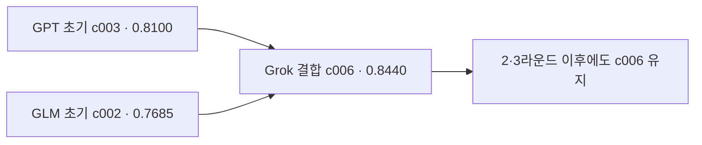

# Co-Scientist 조건 완화 재시험

정식 완료는 **4/8개**다. 이전 시험의 0/10개와 달리 완성된 답을 확보했지만, 같은 과제의 다중 모델·단독 모델 최종 답이 모두 완료된 비교는 **0/6개**다. 따라서 ReasonLineage의 우위를 판단할 수 없다. 완료 답변에 대한 별도 LLM 평가 네 번은 모두 완료했으며, 전문가의 익명 평가는 대기 중이다.

이번 진단에서 **같은 ALS 원문을 Opus 5.5의 `[bio]` 안전장치가 차단**했다. [공개 진단 기록](evidence/2026-10-06-co-scientist-rerun/diagnostics/als-error-detail-receipt.json). 중립 질문 두 가지는 통과했다. 사용자 선택에 따라 ALS·AML은 유지하고 Opus를 제외했다. 이는 이번 입력의 차단을 확인한 것이며, 모든 생의학 질문이 차단된다는 결론은 아니다. 앞선 시험에서 저장되지 않은 원래 stderr의 정확한 원인을 소급 확정하지 않는다.

## 실제 실행 조건

생성 모델은 `gpt-6.1-sol`(xhigh), `grok-4.7`(xhigh), `glm-5.3-flash`(max)다. 기존 ALS·AML 문헌 입력을 그대로 고정했다. [Co-Scientist 논문](https://www.nature.com/articles/s41586-026-10644-y)의 과제 목표를 바탕으로 구성한 시험이며, 논문의 전체 시스템·비공개 원문 프롬프트·실험 검증을 재현한 것은 아니다. 입력 문헌은 2025년 이전 자료지만 모델의 사전 학습 지식을 제거하지는 못한다.

다중·단독 방법 모두 초기 가설 네 개, 후보당 비판 두 번, 수정 라운드 세 번으로 맞췄다. 다중 방법은 작성자를 제외한 두 모델이 비판하고, 단독 방법은 같은 모델의 새로운 세션 두 개가 비판한다. 정상 실행은 작성 열 번·비판 스무 번으로 총 30회다. 사용할 수 없는 반환 형식에만 한 번 재요청을 허용하고 실제 접수 상한은 40회로 두었다. 백엔드 오류·시간 초과·명시적 거절에는 재시도하지 않았다.

실행별 45분·보고 토큰 80만, 요청별 10분, 전체 4시간·생성 단계 200분이다. 400–800단어는 권장 범위로 바꿔 유효한 긴 답도 보존했다. 완료된 Grok ALS 최종 답의 992단어도 이 규칙으로 수용했다.

실제 사용 프로필은 **0.3**, 코드 고정은 `eb89bd5a65c97a3c25998f4fecaf3931184f5b22`다. 실행 전 오프라인 검증은 734 passed, 3 live deselected였다. 이후 준비한 0.4 보완과 현재 결과를 구분한다.

## 완료·중단과 내부 선택 점수

| 과제 | 방법 | 상태 | 접수 요청 | 보고 토큰 | 사용량 미확인 | 초기 1위 | 최종 선택 |
|---|---|---|---:|---:|---:|---:|---:|
| ALS | reasonlineage | 요청 10분 초과 | 20 | 245,430 | 1 | 0.8345 | — |
| AML | reasonlineage | 완료 | 30 | 414,374 | 0 | 0.8100 | 0.8440 |
| ALS | gpt | 완료 | 30 | 350,804 | 0 | 0.8610 | 0.8610 |
| AML | gpt | 전체 생성 시간 상한 | 20 | 199,446 | 2 | 0.8650 | — |
| ALS | grok | 완료 | 30 | 539,456 | 0 | 0.7890 | 0.7905 |
| AML | grok | 전체 생성 시간 상한 | 20 | 253,149 | 2 | 0.7300 | — |
| ALS | glm | 완료 | 30 | 261,061 | 0 | 0.8580 | 0.8710 |
| AML | glm | 비판 개수 제한·재요청 형식 실패 | 19 | 162,812 | 1 | 0.8160 | — |

내부 점수는 가설 선택용 fitness다. 생물학적 사실의 정확도나 실험 성공 확률을 측정한 값이 아니다. 작성자에 따라 비판 모델도 달라지므로 방법 간 내부 점수의 단순 비교는 적절하지 않다. 미완료 실행의 초기 점수는 참고 값이며 최종 점수로 대체하지 않았다.

ALS 다중 모델은 두 번째 라운드의 GPT 결합 요청이 10분을 넘겨 중단됐다. AML GLM은 한 평가 응답에 유효한 비판 사항 네 개를 적었는데, 기존 엔진의 ‘최대 세 개’ 제한이 이를 거절했다. 이 네 개는 응답 안의 지적 사항 수이며 평가 호출 횟수가 아니다. 한 번 재요청한 뒤에는 백엔드가 유효한 구조화 응답을 완성하지 못했다. 첫 거절은 내용이 틀렸다는 판정이 아닌 불필요한 형식 제한이었다.

GPT·Grok 단독 AML은 초기와 첫 수정 라운드까지 마쳤지만 전체 생성 시간 상한에 도달했다. 진단·환경 복구가 생성 시작 전 약 95분을 사용했고, 다중 모델 실행 후 각 단독 방법을 ALS→AML 순서로 배치한 결과 AML의 남은 시간이 부족했다. **이 실행 설계가 최종 방법 비교를 확보하지 못했다.** 이러한 중단을 가설 품질 0점이나 알고리즘 효과 없음으로 해석하지 않는다.

## 실제 진화 예시: AML 다중 모델

초기 1위는 GPT의 atovaquone 가설 `c003`(0.8100)이었다. 이를 GLM의 leflunomide/DHODH 가설 `c002`와 결합한 Grok의 `c006`이 0.8440을 받았다. 두 번째·세 번째 라운드의 새 후보들은 이를 넘지 못해 `c006`이 최종 선택됐다. **초기 1위→최종 내부 증가량은 +0.0340**이다.

최종 답은 새로운 약물을 발견했다고 주장하기보다, 특정 잔존 AML 상태에서 atovaquone의 호흡 억제→피리미딘 제한→분화라는 연결을 검증하는 가설을 구체화했다. 원인·대안·노출·정상 세포 비교와 반증 조건을 추가했지만 실제 실험 결과는 없다.

## 별도 LLM 평가

`deepseek-v4.1-flash`(high)가 완료 실행의 익명 초기·최종 답을 과제별 정방향·역방향으로 평가했다. 네 호출 모두 완료됐다. 실제 서로 다른 답은 7개다. GPT ALS는 초기·최종이 같은 답이므로 같은 익명 ID와 같은 평가를 공유한다. 두 순서는 순서 편향 확인이며 독립 표본 두 개를 추가한 것이 아니다.

아래 평균은 근거성·인과 설계·구체성·검증 가능성·실행 가능성 다섯 항목의 1–5 평점에 대한 기술적 요약이다. 사전 등록된 성공 판정 기준이나 정확도는 아니다.

| 과제 | 방법 | 초기 평균 | 최종 평균 |
|---|---|---:|---:|
| AML | reasonlineage | 4.0 | 4.2 |
| ALS | gpt | 3.7 | 3.7 |
| ALS | grok | 3.6 | 4.3 |
| ALS | glm | 3.6 | 4.3 |

AML 다중 모델의 항목별 변화는 근거성 3.5→3.5, 인과 설계 4.0→4.5, 구체성 4.0→5.0, 검증 가능성 4.5→5.0, 실행 가능성 4.0→3.0이다. 구체적 실험 설계가 늘어난 대신 단계와 부담도 커졌다는 평가다. 독립 모델도 여러 수치 기준이 제공 문헌에서 도출되지 않았음을 지적했다. 평균 상승만으로 사실 확인이나 과학적 발견을 주장할 수 없다.

## 문헌 확인에서 남은 판단

주요 전제·선행 연구·승인 적응증을 확인했다. 모든 문장을 포괄적으로 검증하거나 세포·동물 실험을 수행한 것은 아니다. 상세 근거와 범위는 [문헌 검증](evidence/2026-10-06-co-scientist-rerun/literature-verification.md)에 있다.

NUP98 인산화와 핵공 해체의 직접 근거는 주로 유사분열 맥락이다. ALS 운동뉴런에서 p38·CDK5 등이 시작 원인을 만든다는 연결은 별도 가설이다. [Laurell et al., Cell 2011](https://pubmed.ncbi.nlm.nih.gov/21335236/).

Atovaquone의 AML 연구와 소아 AML 병용 가능성 보고, teriflunomide의 AML 분화·저항성 연구는 이미 있다. 이번 답의 특정 잔존 상태·노출·기전 연결의 신규성과 타당성은 따로 검증해야 한다. [Atovaquone AML 연구](https://pubmed.ncbi.nlm.nih.gov/31856268/), [2023 병용 연구](https://pubmed.ncbi.nlm.nih.gov/36831684/), [2025 teriflunomide 연구](https://pubmed.ncbi.nlm.nih.gov/41061202/).

URA1을 이용해 미토콘드리아 호흡과 피리미딘 합성을 분리하는 검증 논리는 포유류 세포 연구의 지지를 받는다. 제안한 AML 상태에서 분화·선택성까지 성립한다는 증거는 아니다. 이 2026년 자료는 외부 확인에만 사용했고 생성 모델·독립 평가자에게 추가 제공하지 않았다. [2026 ScURA 연구](https://pmc.ncbi.nlm.nih.gov/articles/PMC12945687/).

최종 AML 답의 1.5배·70%·20%·3배 등은 제안한 연구의 판단 기준이며 실측·교정된 약리 수치가 아니다. Etomoxir의 비특이적 영향도 보고돼, 그 반응만으로 지방산 산화 의존성을 정의하는 설계에는 별도 검증이 필요하다. 이는 T세포 연구에서 추론한 점검 사항으로, AML 가설 자체의 실패를 입증한 것은 아니다. [Etomoxir 원문 연구](https://pubmed.ncbi.nlm.nih.gov/29674640/).

## 자원과 실행 기록

현재 여덟 실행의 접수 요청 199회 + 이전 중단 시도의 22회 + 독립 평가 4회 = **225회**다. 보고 토큰은 **2,624,904**, 사용량 미확인은 **15회**, 고정된 진단 시계부터 결과 저장까지 약 **201.15분**이다. 토큰은 보고된 입력·출력 합계이며 실제 FLOPs를 측정하지 않았다. 알려진 공급자 비용 부분합은 $1.737193이고 204개 저장 응답 중 136개에는 비용 정보가 없으므로 전체 실제 청구 비용은 확인되지 않았다.

이전 22회에는 진단 네 회가 이미 포함돼 있어 다시 더하지 않았다. 사용량 미확인에는 실행 파일을 찾지 못해 모델로 보내기 전에 실패한 네 건도 보수적으로 포함돼 있다. 접수 요청 수는 실제 원격 모델 호출을 모두 확인한 수와 구분한다. 이전 시도와 원래 진단 시계는 보존했으며 4시간을 다시 시작하지 않았다.

## 자료와 후속 코드 상태

- [정식 전문가용 익명 ZIP](evidence/2026-10-06-co-scientist-rerun/expert-only.zip): 전문가에게는 이 ZIP만 먼저 전달한다. 방법·단계 대응표와 자동 점수·문헌 확인 결론은 포함하지 않는다. 익명 답 7개, 공통 문헌, 빈 평가 양식이 들어 있다.
- [미완료 가설의 전문가 참고 ZIP](evidence/2026-10-06-co-scientist-rerun/expert-reference-only.zip): 초기·마지막 공개 가설 11개다. 정식 익명 평가를 먼저 마친 뒤 참고 평가한다. 이번 네 LLM 호출의 평가 대상은 완료 실행의 7개 답이었다.
- [모델별 전체 공개 답변·비판](evidence/2026-10-06-co-scientist-rerun/public-candidates/README.md), [후보 계보 CSV](evidence/2026-10-06-co-scientist-rerun/evolution.csv): 등록 후보 64개와 별도로, 등록 전 작성은 끝났으나 동시 요청 실패로 평가되지 못한 ALS Grok 답도 공개 응답 기록에 보존했다.
- [전체 상태](evidence/2026-10-06-co-scientist-rerun/study.json), [독립 평가 요약](evidence/2026-10-06-co-scientist-rerun/independent-summary.json), [검증 기록](evidence/2026-10-06-co-scientist-rerun/verification.json).

다음 실행용 프로필 **0.4**는 유효한 비판 사항을 전부 보존하고 개수를 경고로 처리한다. 요청 상한은 실행별 45분 안에서 남은 실행·전체 예산으로 제한하도록 바꿨다. 기존 기본·엄격 프로필은 유지한다. 후속 코드 `a0f83d2`의 오프라인 검증은 **738 passed, 3 live deselected**다. **0.4를 적용한 추가 실제 생성 시험은 하지 않았다.** 현재 표의 0.3 결과를 성공으로 바꾸거나 이전 결과를 덮어쓰지 않았다.

전문가 판단은 아직 수령하지 않았다. 두 과제의 모든 방법 최종 답과 사용량 비교 기준을 충족한 결과가 없어, 이번 단계에서는 다중 모델의 우위에 대한 결론을 유보한다.
