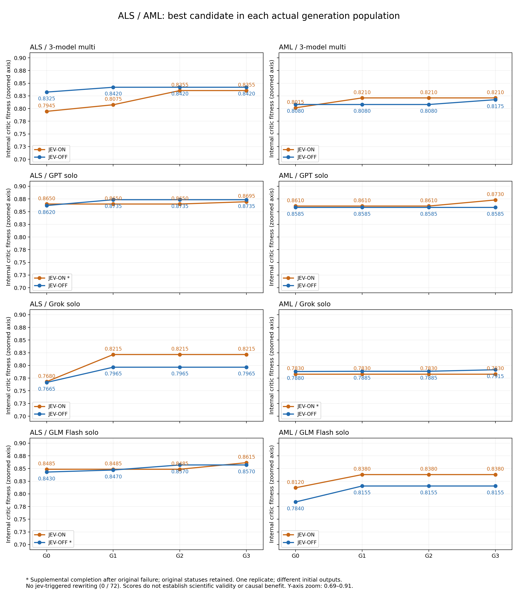

# ALS·AML 전체 재실행: jev ON/OFF 비교

2026-10-09. **계획된 16개 조건의 최종 결과를 모두 확보했다.** 원래 실행 제한 안에서 13개가 완료됐고, 실패한 3개는 별도 폴더에서 누락된 마지막 단계만 보완했다. 원본 실패 상태와 로그는 그대로 보존했다.

이번 실험에서 **jev J1의 실제 재작성은 0회/72개 가설**이었다. 따라서 아래 점수 차이는 jev가 구조 결함을 수정한 효과를 입증하지 않는다. 질문과 요청 seed는 같았지만 두 조건의 초기 답변부터 달랐다.

## 실험 구성

ALS·AML × 다중 모델·GPT 단독·Grok 단독·GLM Flash 단독 × jev ON/OFF = 16개. Opus·DeepSeek·Laya 호출은 없다. 조건별 한 번의 실행이며, ON 다음 OFF 순서였다. 동일한 질문·문헌 패킷·프롬프트·모델 설정·요청 seed·진화 규칙을 사용했고 입력과 코드 SHA를 보존했다.

각 실행은 초기 G0 가설 3개와 G1·G2·G3의 새 가설 각 2개, 총 9개를 만든다. 생존자는 가설 2개이며 모델 2개를 영구 선택하는 뜻은 아니다. 다중 모델은 생존 2개에 변이 1개·교차 1개를 더한다. 단독 구성은 변이 2개를 더한다. 새 가설마다 다중 구성은 작성자를 제외한 2모델, 단독 구성은 별도 호출의 자기 비판 2회로 채점한다. 생존 가설은 기존 평가를 유지한다. G3의 실제 후보 4개 중 가장 높은 fitness를 반환한다.

내부 fitness는 evidenceCoverage·specificity·novelty·actionability의 두 평가를 축별 중앙값으로 합친 가중 점수다. 모델이나 평가 구성 사이에 공통 외부 채점 척도로 보정하지 않았으므로 다중·단독의 절대 점수만으로 우열을 판단하지 않는다. 같은 다중 구성 안에서도 최종 작성자가 바뀌면 작성자를 제외하는 평가 조합이 달라질 수 있다.

## 결과

별표(*)는 원본 실패 뒤 마지막 단계만 별도 완료한 결과다. Δ는 최종−초기 1위이며, ON−OFF는 최종 값 차이다.

| 과제 | 구성 | ON 초기→최종 | ON Δ | OFF 초기→최종 | OFF Δ | ON−OFF |
|---|---|---:|---:|---:|---:|---:|
| ALS | 3-model multi | 0.7945→0.8355 | +0.0410 | 0.8325→0.8420 | +0.0095 | -0.0065 |
| ALS | GPT solo | 0.8650→0.8695* | +0.0045 | 0.8620→0.8735 | +0.0115 | -0.0040 |
| ALS | Grok solo | 0.7680→0.8215 | +0.0535 | 0.7665→0.7965 | +0.0300 | +0.0250 |
| ALS | GLM Flash solo | 0.8485→0.8615 | +0.0130 | 0.8430→0.8570* | +0.0140 | +0.0045 |
| AML | 3-model multi | 0.8015→0.8210 | +0.0195 | 0.8080→0.8175 | +0.0095 | +0.0035 |
| AML | GPT solo | 0.8610→0.8730 | +0.0120 | 0.8585→0.8585 | +0.0000 | +0.0145 |
| AML | Grok solo | 0.7830→0.7830* | +0.0000 | 0.7880→0.7915 | +0.0035 | -0.0085 |
| AML | GLM Flash solo | 0.8120→0.8380 | +0.0260 | 0.7840→0.8155 | +0.0315 | +0.0225 |

다중 구성은 ALS에서 ON 0.0410, OFF 0.0095, AML에서 ON 0.0195, OFF 0.0095 상승했다. AML Grok ON과 GPT OFF는 초기 1위가 최종에도 그대로 선택돼 상승이 없었다. ON−OFF 차이가 양수인 경우와 음수인 경우가 함께 있으며, 동일한 시작 가설을 공유한 실험은 아니다. 한 번의 실행·순차 조건 순서·공급자 응답 변동·일부 후속 보완이 있으므로 jev의 인과효과나 통계적 유의성을 주장하지 않는다.

그림은 각 세대의 실제 후보 집단에서 가장 높은 점수를 표시한다. 전체 과거 가설의 누적 최고값을 그린 것이 아니다. 점수 변화를 읽기 위해 세로축을 0.69–0.91로 확대했으며, 원래 fitness 범위는 0–1이다.

## 실패와 보완

| 조건 | 원본 실패 | 보완 작업 |
|---|---|---|
| ON / ALS / GPT | 45분 상한: 마지막 가설의 평가 2회 누락 | 기존 9개 가설을 유지하고 평가 2회·jev J2 27회만 추가 |
| ON / AML / Grok | 45분 상한: 마지막 평가 1회 누락 | 기존 9개 가설을 유지하고 평가 1회·jev J2 27회만 추가 |
| OFF / ALS / GLM | G3 c009 구조화 응답 오류 | 성공한 기존 22개 호출을 정확히 재사용하고, 원래 예정된 c009 1개와 평가 4회만 보완 |

GLM은 첫 보완(seed attempt 1)도 같은 응답 오류로 실패했다. 그 기록을 보존하고, HTTP 응답의 종료 사유·수치 사용량만 관찰하는 별도 보완 경로를 추가했다. 형식 오류는 후보로 채택하지 않고 기존 형식 재시도 대상이 되도록 처리했다. 실제 추가 writer attempt 2는 같은 모델·프롬프트·max_tokens 32768·effort로 정상 JSON을 반환했다. 원래 두 실패의 응답 본문·종료 사유는 남아 있지 않아 길이 초과인지 JSON 미출력인지 단정할 수 없다. 생성 조건을 바꾸거나 앞선 성공 답변을 새로 뽑지 않았고, 새 세대나 예정 외 가설도 추가하지 않았다.

원본 ON/OFF 실행에는 코드 동결을 적용했다. 보완 코드는 별도 audit script에만 추가했으며 원본 엔진·설정·프로토콜은 바꾸지 않았다. 보완은 원본 종료 후 진행했고 단계별 최대 15분, 누적 모델 40회/jev 70회, 최초 시작부터 전체 8시간 한도 안에서 수행했다. 다만 실패 호출의 실제 토큰 사용량이 미확인이라 해당 세 실행의 원래 800k 토큰 상한 충족 여부를 정확히 검증할 수 없다.

## jev 관측

ON J1 72개, J2 216개. 재작성 0회, 미해결 판단 0개. 모든 ON 가설이 J1 구조 관문을 통과했다.
J1은 가설 존재 Noul, 우선 결함 Choice, 기전·근거 구분·검증 전략·반증 관찰 Score를 연결해 재작성 여부를 결정한다. 임계값 0.5는 충분할 확률 P(2)+P(3)에 적용한다. jev 값은 가설의 사실성이나 실험 성공 확률이 아니다.

J2는 수사적 강조와 비판 심각도를 진단해 기록했다. 정답 임상 결과 목록이 없어 outcome_mention은 건너뛰었다. J2는 생존 선택·fitness·재작성에 사용하지 않았다. OFF에는 jev 검사·진단 호출이 없다.

실서비스에서 실제 가설을 검사해 통과시킨 경로는 확인했다. 실제 가설의 결함을 고쳐 성능이 오르는지는 이번 실험에서 관측하지 못했다. 이전 인위적 결함·수정 경로 검증은 [별도 보고서](2026-10-09-jev-combined.md)에 있다.

## 실제 호출과 사용량

| 구분 | 모델 호출 | jev 호출 | 보고된 토큰 합계 | 사용량 미확인 호출 |
|---|---:|---:|---:|---:|
| jev-on (실패·보완 포함) | 220 | 288 | 3,456,413 | 3 |
| jev-off (실패·보완 포함) | 218 | 0 | 2,970,721 | 2 |

총 726회, 보고된 토큰 6,427,134개, 사용량 미확인 5회. 저장 답변의 재생은 새 호출·새 토큰으로 중복 합산하지 않았다.
토큰은 공급자 보고값이며 캐시·추론을 포함하는 사용량이다. 미확인 호출을 0토큰으로 간주하지 않았고, 정확한 비용이나 동등 연산량 비교를 주장하지 않는다.

## 내용 검증과 전문가 평가

익명 전문가 자료는 32개 초기/최종 참조, 중복 제거 후 30개 답변으로 준비했다. 익명화 제외 0개. 공개 패킷에 모델·ON/OFF·세대·fitness·비교 관계를 표시하지 않는다.
전문가는 공통 근거 패킷을 보고 grounding·causal rigor·specificity·testability·feasibility를 1–5로 평가하고 과제별 전체 순서를 작성할 수 있다. 분석용 매핑은 별도 폴더에 있다. **실제 전문가 평가, 개별 인용 주장 확인, 약물 승인·노출 검증은 아직 수행되지 않았다.**

Google co-scientist와의 후속 비교는 내부 점수 대신 최종 기전, 근거와 추측의 구분, 반증 가능한 예측, 검증 전략을 대상으로 해야 한다. 현재 산출물은 그 내용 비교를 위한 입력이며 실험적 발견의 재현을 보여 준 자료는 아니다.

## 전체 기록 보기

- [한눈에 보는 진화 뷰어](evidence/2026-10-09-jev-controlled/run/evolution-viewer.html): 과제·구성·ON/OFF 선택, 모든 가설 원문·부모·점수·비판·jev 판정.
- [144개 가설 점수 CSV](evidence/2026-10-09-jev-controlled/run/candidate-scores.csv), [64개 세대 점수 CSV](evidence/2026-10-09-jev-controlled/run/generation-scores.csv).
- [보완을 구분한 전체 결과 JSON](evidence/2026-10-09-jev-controlled/run/completed-summary.json), [원본 비교](evidence/2026-10-09-jev-controlled/run/report.md).
- [전문가용 패킷](evidence/2026-10-09-jev-controlled/run/completed-review-materials/expert/README.md): analyst 폴더를 함께 전달하지 않는다.
- [목적·방법 문서](2026-10-09-reasonlineage-purpose-and-method.md).

144개 가설의 fitness를 원래 평가 축·가중치로 다시 계산해 일치를 확인했다. 실행 전 전체 오프라인 테스트 796개와 보완 경로 테스트 11개를 통과했다. 뷰어의 16개 조합을 DOM 렌더 로직으로 확인했으며 실제 브라우저 스크린샷 검증은 수행하지 않았다.

기존 증거 1,210개 파일의 SHA가 그대로 유지됐고, 공개 자료에서 jev 키·자격 증명 패턴·비공개 추론 JSON 필드는 검출되지 않았다. 실제 실행의 마지막 기록은 UTC 17:13:50으로 최초 시작부터 약 5시간 36분이었다. [검증 기록](evidence/2026-10-09-jev-controlled/verification.json), [보안 확인](evidence/2026-10-09-jev-controlled/security-check.json), 동결 입력·원본·보완 로그는 [증거 보관 폴더](evidence/2026-10-09-jev-controlled/README.md)에 보존했다.
