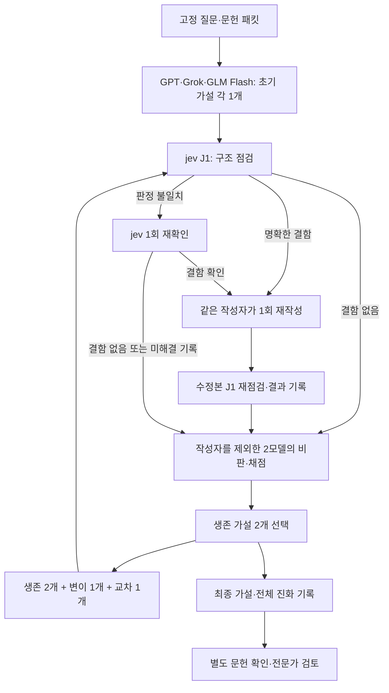

# ReasonLineage 실험의 목적과 방법

작성일: 2026-10-09
대상: GPT·Grok·GLM Flash의 가설 진화와 jev 구조 점검을 결합하는 현재 실험

## 1. 이 실험을 하는 이유

이 연구는 **여러 모델이 서로의 가설을 비판하고, 수정하고, 결합하는 과정이 단일 모델의 반복 개선보다 도움이 되는지** 확인하려는 실험이다. 처음부터 좋은 답이 나오더라도, 최종 점수만 보고 판단하지 않고 어떤 비판이 어떤 수정으로 이어졌는지 추적한다.

Google co-scientist 논문에서 다룬 ALS·AML 연구 문제를 실험의 출발점으로 삼는다. 논문에 제시된 점수와 우리 내부 점수를 직접 비교하는 것이 목적은 아니다. 가설의 내용, 제안한 기전, 반증 가능한 예측, 검증 전략, 개선 과정이 논문에서 보여 준 접근과 어떻게 비슷하거나 다른지 비교하려는 것이다.

현재는 이 연구의 한 부분인 **“불완전한 가설을 언제, 무엇을 고치도록 돌려보낼 것인가”**를 구현하고 먼저 검증하고 있다. jev가 가설의 구조를 점검하고, 결함이 확인되면 원래 작성 모델이 한 번 수정하도록 만든다.

## 2. 어떤 문제를 다루는가

| 과제 | 가설이 답해야 하는 방향 | 입력 |
|---|---|---|
| ALS | TDP-43 관련 병리와 핵공·핵수송 이상을 연결하는 기전 가설과 이를 구분해 검증할 방법 | 고정된 질문과 문헌 근거 패킷 |
| AML | 기존 약물의 재창출을 통한 AML 분화 유도 가설과 기전·검증 전략 | 고정된 질문과 문헌 근거 패킷 |

모델의 출력은 하나의 연구 가설이다. 핵심 주장, 작동 기전, 근거와 추측의 구분, 대안 설명, 검증 전략, 반증 관찰, 한계를 포함하도록 요구한다. 이 출력은 연구 제안이며, 실제 실험으로 확인된 발견을 뜻하지 않는다.

## 3. 모델별 역할

| 구성 요소 | 현재 역할 |
|---|---|
| GPT | 초기 가설 작성, 다른 작성자의 가설 비판·채점, 후속 가설 생성 |
| Grok | 초기 가설 작성, 다른 작성자의 가설 비판·채점, 후속 가설 생성 |
| GLM-5.3-Flash | 초기 가설 작성, 다른 작성자의 가설 비판·채점, 후속 가설 생성 |
| jev J1 | 채점 전 가설의 구조 결함을 검사하고 재작성 여부·수정 대상을 결정 |
| jev J2 | 별도 진단 결과를 기록; 현재 생존자 선택이나 재작성을 결정하지 않음 |

Opus는 현재 생성·채점 구성에서 제외되어 있다. DeepSeek와 Laya도 이 실행 구성에 포함하지 않는다.

**jev가 가설의 최종 순위를 정하지는 않는다.** J1 결과를 기록한 가설의 연구적 가치는 작성자를 제외한 두 모델이 비판하고 채점한다. 잔여 결함이나 미해결 판단이 있으면 그 상태도 보존한다. 문헌의 실제 내용과 가설의 과학적 타당성을 확인하는 작업은 구조 점검과 별도로 수행해야 한다.

## 4. 다중 모델 가설 진화 방법

1. **초기 가설 3개:** GPT·Grok·GLM Flash가 각각 하나씩 작성한다. 한 모델에 초기 작성 기회를 추가로 주지 않는다.
2. **J1 구조 점검:** 각 새 가설을 jev가 검사한다. 명확한 결함이면 같은 작성자가 한 번 재작성하고, 수정본을 다시 검사한다.
3. **교차 비판과 채점:** 작성자를 제외한 두 모델이 해당 가설을 평가한다.
4. **생존 가설 2개 선택:** 내부 적합도 점수로 두 가설을 유지한다. “생존자 2개”는 모델 두 개를 영구적으로 선택한다는 의미가 아니다.
5. **다음 세대 생성:** 생존 가설 2개를 유지하면서 변이 1개와 교차 1개를 추가한다. 따라서 이후 세대의 후보는 총 4개다.
6. **반복과 기록:** 새로 생성된 후보에 대해 점검·비판·채점·선택을 반복한다. 초기 답, 수정본, 부모 관계, 비판, 점수, 호출 기록을 보존한다.

변이는 기존 가설을 비판에 맞춰 개선하는 작업이다. 교차는 두 부모 가설의 아이디어를 결합해 새 가설을 만드는 작업이다. 두 작업 모두 실제로 작성된 내용을 확인해야 유의미한 변화인지 판단할 수 있다.

현재 프로토콜은 초기 G0 이후 G1·G2·G3의 세 진화 세대를 사용한다. 단일 모델 비교에서는 같은 초기 후보 수·생존 가설 수·두 번의 독립 자기 비판을 적용하고, 후속 후보는 해당 모델의 변이로 만든다.



미해결 판정과 검사 실패는 기록에 남고 J1 상태가 `partial`이 된다. 현재 설계에서는 해당 후보의 후속 평가가 계속될 수 있지만, 이를 정상적으로 점검 완료된 결과로 표시하지 않는다. 한 번 수정한 뒤에도 결함이 남으면 추가 재작성 없이 잔여 결함을 기록한다.

## 5. jev의 세 타입을 연결하는 방법

Noul·Choice·Score는 한 답변에 대해 각각 판단을 반환한다. 우리 코드는 그 결과를 조건부 규칙으로 연결한다. 세 결과를 독립 확률로 가정해 곱하거나 단순 평균하지 않는다.

현재 J1은 **Noul 1문항 + Choice 1문항 + Score 4문항**, 총 6문항으로 구성된다.

| 타입 | 묻는 내용 | 사용 방법 |
|---|---|---|
| Noul | 답변 본문에 실제 연구 가설이 있는가? | `P(yes) < 0.5`이면 전체 가설을 다시 쓰도록 요청 |
| Choice | 가장 먼저 보완할 구조 항목은 무엇인가? | 수정의 우선 대상을 정함 |
| Score × 4 | 기전·근거 구분·검증 전략·반증 관찰 각각 얼마나 충실한가? | 해당 항목이 실제로 부족한지 확인 |

Choice의 선택지는 기전, 근거 구분, 검증 전략, 반증 관찰, 가설 없음, 판단 불확실, 결함 없음이다. 가장 높은 확률의 선택지를 우선 대상으로 사용한다.

Score는 각 항목에 대해 0–3 단계의 확률 분포를 반환한다.

| 단계 | 구조 충실도 해석 |
|---|---|
| 0 | 해당 내용 없음 |
| 1 | 모호하거나 불충분함 |
| 2 | 필요한 내용이 충분히 제시됨 |
| 3 | 필요한 내용이 명확하게 제시됨 |

각 항목의 충실도 판정에는 다음 값을 사용한다.

```text
충분할 확률 = P(단계 2) + P(단계 3)
부족한 항목 = 충분할 확률이 0.5 미만인 항목
```

0.5와 같은 값은 통과한다. 단계의 기대 점수도 기록할 수 있지만, 재작성 기준은 기대 점수 자체가 아니라 위의 확률 질량이다. 이 확률은 jev가 주어진 문구에 대해 반환하는 모델 판단값이며, 현실에서 가설이 맞을 확률이나 실험 성공률을 의미하지 않는다.

## 6. 재작성 결정을 내리는 순서

1. **가설이 없으면:** Noul이 0.5 미만이므로 전체 가설을 다시 작성한다. 이 경우 Choice·Score를 억지로 해석하지 않는다.
2. **가설이 있고 결함도 없으면:** Choice가 ‘결함 없음’이고 네 Score 항목이 모두 충분하면 원본을 유지한다.
3. **결함 판단이 일치하면:** Choice가 선택한 항목이 Score에서도 부족하면 재작성한다. 다른 부족한 항목도 함께 수정하되, Choice가 고른 항목을 먼저 제시한다.
4. **판단이 불일치하면:** 같은 답변 본문을 대상으로 jev를 한 번만 재확인한다. 재확인 뒤에도 불일치하면 `needs_review`를 기록하며 자동 재작성을 발동하지 않는다.
5. **작성자는 한 번만 수정한다:** 수정본을 다시 점검해 결과를 남기되, 같은 후보를 계속 재작성하는 루프는 만들지 않는다.

### 예시 — 실제 측정값이 아닌 설명용 수치

가설 본문에 기전과 근거는 있지만, 대안 설명과 구분할 검증 전략이 없고 반증 관찰도 빠졌다고 하자.

| 항목 | 설명용 결과 |
|---|---:|
| Noul: 가설 있음 | 0.95 |
| Choice: 우선 결함 | 검증 전략 |
| Score: 기전 충분 | 0.90 |
| Score: 근거 구분 충분 | 0.80 |
| Score: 검증 전략 충분 | 0.20 |
| Score: 반증 관찰 충분 | 0.30 |

이 경우 가설은 존재하고, Choice와 Score가 검증 전략의 결함에 동의한다. 따라서 원래 작성자에게 **검증 전략을 먼저 보완하고 반증 관찰도 함께 추가하도록 한 번 요청**한다. 수정본의 Score가 높아져도 그것만으로 과학적으로 입증됐다고 판단하지 않는다.

## 7. 연구적 가치의 평가와 구조 점검의 차이

생존 가설을 고르는 내부 채점은 생의학적 타당성, 근거, 구체성과 새로움, 실행 가능성 등을 프로토콜의 평가 축과 가중치에 따라 판단한다. 이 점수와 jev의 구조 충실도는 서로 다른 의미를 갖는다.

예를 들어 논리의 형태가 완전해도 근거로 든 논문이 실제로 주장을 뒷받침하지 않을 수 있다. 반대로 흥미로운 아이디어라도 검증 전략이 빠져 있으면 비교 가능한 연구 제안으로 다듬을 필요가 있다. J1은 후자의 구조 결함을 발견해 수정하도록 돕는다.

현재 J1은 supplied evidence packet과 답변을 입력으로 받지만, 논문 전문을 스스로 검색·열람하는 절차가 아니다. ‘근거 구분 충분’은 **답변에서 근거와 추측을 구분해 썼는지**에 대한 판단이다. 인용의 정확성, 약물 승인 정보, 실제 노출 가능성, 기전의 사실성은 별도 문헌 확인 대상이다.

## 8. 먼저 무엇을 검증하는가

현재 구현 점검은 다음 순서로 진행한다.

1. 자동 테스트로 임계값, 판단 불일치, 검사 재사용, 재작성 횟수, 기존 실행과의 호환성을 확인한다.
2. 정상 가설과 의도적으로 구조 항목을 삭제한 가설, 거절·메타·채점자 개입 답변을 만들어 실제 jev가 올바르게 분류하는지 확인한다.
3. 별도 표현의 검증 자료로 같은 기준이 작동하는지 확인한다.
4. 기존 실제 모델 답변에서 검증 전략·반증 관찰을 제거하고, jev 판정 후 원래 작성 모델이 한 번 수정하는 경로를 확인한다.

이 검증은 구조 결함 탐지와 실행 경로가 작동하는지 확인하는 과정이다. 소수의 인위적 결함 사례에서 성공했다고 해서 실제 가설 전체에서의 오탐률이나 과학적 성과가 입증되는 것은 아니다.

## 9. 현재 상태와 다음 연구 판단

새 조합 규칙의 구현과 제한된 실서비스 검증을 먼저 마쳤다. 개발용48개·별도 표현48개의 jev 판정과 ALS·AML 각각의 실제 GLM Flash 1회 수정 경로를 확인했다. 이 단계의 세부 결과와 한계는 [검증 보고서](2026-10-09-jev-combined.md)에 정리했다.

이후 사용자 추가 승인으로 **jev ON/OFF 대조군을 포함한 전체 16개 조건의 최종 결과를 확보했다.** ALS·AML 각각 다중 모델·GPT 단독·Grok 단독·GLM Flash 단독을 두 조건에서 한 번씩 실행했다. 원래 제한 안에서 13개가 완료됐고, 실패한 3개는 별도 폴더에서 누락된 마지막 단계만 보완했다. 두 군 모두 DeepSeek는 없고 질문·문헌 패킷·프롬프트·모델 설정·초기 3·생존 2·세 진화 세대를 유지했다. [전체 비교 보고서](2026-10-09-jev-controlled.md)와 [진화 뷰어](evidence/2026-10-09-jev-controlled/run/evolution-viewer.html)에 결과를 정리했으며, 기존 결과와 원본 실패 상태를 보존했다.

총 144개 가설과 288개 비판을 기록했다. ON의 72개 가설이 J1 구조 검사를 통과해 이번 전체 실행에서는 **jev 재작성 0회**였다. 따라서 ON/OFF 점수 차이를 jev 수정 효과로 해석하지 않는다. 실제 전문가 평가와 개별 인용 주장 검증은 아직 수행되지 않았다.

이 비교에서는 jev가 포함됐을 때의 결과와 추가 검사·수정 비용을 함께 살핀다. 조건별 한 번이고 같은 요청seed가 결정적 응답을 보장하지 않으므로, 차이를 일반적인 인과효과나 통계적 유의성으로 단정하지 않는다.

이후 전체 실험에서는 내부 점수 변화뿐 아니라 다음을 비교해야 한다.

- 어떤 구조 결함이 탐지되었고, 수정본에서 실제로 해소되었는가?
- 수정으로 유용한 내용을 잃거나 근거 없는 내용을 추가하지 않았는가?
- 다중 모델 진화가 단일 모델 반복 개선보다 내용상 이점을 보이는가?
- 문헌 확인과 전문가 평가에서도 개선을 인정할 수 있는가?
- Google co-scientist가 보고한 가설·검증 접근과 어떤 공통점과 차이가 있는가?

이 판단을 통해 구조 점검이 연구 제안을 정돈하는 데 도움이 되는지, 그리고 그 효과가 실제 가설 개선으로 이어지는지 구분해 확인한다.

## 관련 파일

- [현재 jev 조합 프로필](../research/co-scientist-pilot/protocol-jev-combined/protocol.json)
- [재작성 결정 코드](../src/reasonlineage/checks/combined.py)
- [J1 점검 및 재확인 코드](../src/reasonlineage/checks/gate.py)
- [실행 코드](../src/reasonlineage/pilot/run.py)
- [이전 jev 관문 검증 보고서](2026-10-08-jev-gate.md)
- [이전 ALS 결과](2026-10-07-als-timeout-retry.md)
- [이전 AML 결과](2026-10-08-aml-solo-retry.md)
