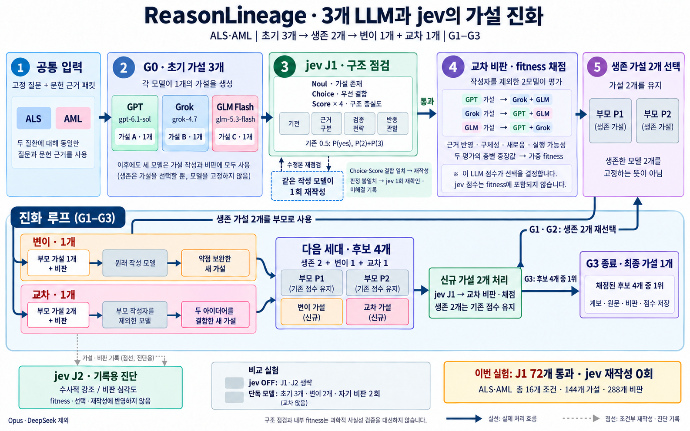

# ReasonLineage · 3개 LLM과 jev의 가설 진화

내장 image_gen 도구로 생성하고 반복 흐름의 연결선을 수정한 최종 피규어다.

실제 사용 모델: GPT gpt-6.1-sol (xhigh), Grok grok-4.7 (xhigh), GLM Flash glm-5.3-flash (max).

초기 각 1개, 가설 2개 생존, 후속 변이 1개·교차 1개. 변이는 부모 작성자가 비판을 반영하고, 교차는 부모 작성자를 제외한 모델이 두 가설을 결합한다. 신규 가설에 J1 점검과 작성자 제외 2모델 평가를 적용하며 생존 가설은 기존 점수를 유지한다. G1·G2에서는 생존자 2개를 다시 선택하고 G3 종료 시 최종 후보 4개에서 1위를 반환한다.

jev J1의 점선 경로는 조건부 재작성이다. Noul 가설 존재 판정이 부족하면 전체 재작성, Choice와 Score의 결함 판단이 일치하면 해당 항목을 보완한다. 불일치는 한 번 재확인하고 미해결이면 기록한다. 원래 작성자의 재작성은 최대 1회이다. jev J2는 기록용 진단이다. 이번 실제 실행의 J1 재작성은 0회였다.

## 생성·수정 프롬프트 모음

### Prompt 1

Use case: infographic-diagram.
Asset type: one finished scientific workflow figure for the ReasonLineage project, high-resolution landscape, roughly 16:10. Audience: Korean-speaking researcher who wants to understand exactly which LLMs create, mutate, cross, criticize and select hypotheses, and what jev does.
Primary request: Draw ONE polished, legible Korean overview diagram of the actual three-LLM ReasonLineage + jev pipeline. Render Korean text accurately, with large readable sans-serif typography, precise arrowheads, generous whitespace, and a restrained scientific journal infographic style on opaque white background. Flat boxes/cards, thin connectors, no 3D, no robots, no decorative biology scenes, no invented logos. The information flow is more important than decoration.

Title, verbatim: "ReasonLineage · 3개 LLM과 jev의 가설 진화"
Subtitle, verbatim: "ALS·AML | 초기 3개 → 생존 2개 → 변이 1개 + 교차 1개 | G1–G3"

Organization:
Use a clear numbered main pipeline across the upper half and an evolutionary feedback loop across the middle/lower half. At the bottom put a small separate diagnostics/comparison band and an actual-observation badge. Do not crowd all text into a long horizontal strip. Main steps should dominate visually, and jev should be clearly distinguishable from the LLM critics. Use a consistent unobtrusive color for each generator family; jev gets its own green/teal color.

MAIN PIPELINE, connected with solid arrows, exact labels:
1. "공통 입력" with "고정 질문 + 문헌 근거 패킷", and small case chips "ALS" and "AML".
2. "G0 · 초기 가설 3개": three distinct author cards, each clearly creates ONE hypothesis:
   "GPT" with "gpt-6.1-sol" and "가설 A · 1개"
   "Grok" with "grok-4.7" and "가설 B · 1개"
   "GLM Flash" with "glm-5.3-flash" and "가설 C · 1개".
   These same three model families remain available to write and criticize later; survival selects hypotheses, not permanently retained model families.
3. "jev J1 · 구조 점검", clearly BEFORE peer scoring.
   Exact short lines: "Noul · 가설 존재", "Choice · 우선 결함", "Score × 4 · 구조 충실도".
   Under Score show the four components: "기전 / 근거 구분 / 검증 전략 / 반증 관찰".
   Show small threshold line "기준 0.5: P(yes), P(2)+P(3)".
   A solid pass arrow, label "통과", connects J1 to step 4.
   Add one small dashed conditional branch from J1 to a separate pale box labelled "같은 작성 모델이 1회 재작성", then a dashed return to J1 labelled "수정본 재점검".
   Explain in a compact nearby callout: "Choice·Score 결함 일치 → 재작성" and "판정 불일치 → jev 1회 재확인 · 미해결 기록".
   This dashed rewrite branch is a designed conditional route and was not activated in the actual trial. It is distinct from the next-generation mutation path below.
4. "교차 비판 · fitness 채점".
   Large line: "작성자를 제외한 2모델이 평가".
   Three small accurate author-to-critic mappings:
   "GPT 가설 → Grok + GLM"
   "Grok 가설 → GPT + GLM"
   "GLM 가설 → GPT + Grok".
   Short scoring explanation: "근거 반영 · 구체성 · 새로움 · 실행 가능성"
   "두 평가의 축별 중앙값 → 가중 fitness".
   These LLM scores determine selection; jev scores are NOT part of fitness.
5. "생존 가설 2개 선택".
   Depict two surviving hypothesis cards "부모 P1" and "부모 P2", labelled "가설 2개를 유지".
   Small explanatory line: "생존한 모델 2개를 고정하는 뜻이 아님".

EVOLUTIONARY LOOP:
From the two surviving parents make two separate branches, legible and concrete:
- "변이 · 1개": "부모 가설 1개 + 비판" → "원래 작성 모델" → "약점 보완한 새 가설".
- "교차 · 1개": "부모 가설 2개 + 비판" → "부모 작성자를 제외한 모델" → "두 아이디어를 결합한 새 가설".
Both feed a clear population box titled "다음 세대 · 후보 4개". Show four little cards, two grey retained parents and two fresh offspring, with exact formula "생존 2 + 변이 1 + 교차 1".
Make a solid curved feedback arrow FROM this population to jev J1 labelled "신규 2개만 점검·채점". Important: retained parents keep their saved scores; add "생존 2개는 기존 점수 유지". The loop must NOT go to the initial-G0 model generator box, because initial hypotheses are not regenerated each round.
Put "G1 → G2 → G3" on the loop and a final exit box "G3 종료 · 최종 가설 1개" with "계보 · 원문 · 비판 · 점수 저장".

SEPARATE DIAGNOSTICS AND COMPARISON BAND:
A smaller visually separate jev J2 box, linked only by faint dotted arrows from hypothesis/critique records, labelled:
"jev J2 · 기록용 진단"
"수사적 강조 / 비판 심각도"
"fitness·선택·재작성에 반영하지 않음".
Do not show an arrow from J2 into selection or rewriting.
A small neighboring comparison box:
"비교 실험"
"jev OFF: J1·J2 생략"
"단독 모델: 초기 3개 · 변이 2개 · 자기 비판 2회".
No crossover in the single-model comparator. No Opus or DeepSeek model cards; small footer note "Opus·DeepSeek 제외".

ACTUAL OBSERVATION BADGE, unmistakable:
"이번 실험: J1 72개 통과 · jev 재작성 0회"
Under it, smaller text "ALS·AML 총 16개 조건 · 144개 가설 · 288개 비판".
Tiny footnote: "구조 점검과 내부 fitness는 과학적 사실성 검증을 대신하지 않습니다."
Legend: "실선: 실제 처리 흐름 / 점선: 조건부 재작성·진단 기록".

Accuracy constraints: Only the three actual model names above. Jev is an inspector/diagnostic system, never a fourth hypothesis author or fitness judge. Initial total is 3, next population is 4, retained hypotheses 2, new mutation 1 and crossover 1, three rounds G1–G3, final selection one. Do not confuse mutation across generations with the optional jev-triggered same-author structural rewrite. No invented numerical fitness scores, no claim that jev improved results, no invented probability multiplication. Readability and correct topology outrank decorative elements.

### Prompt 2

Use case: infographic-diagram edit. Input image is the edit target. Preserve the title, upper five numbered panels, model names, all correct Korean typography, colors, mutation/crossover branches, jev J2 band, comparison box and bottom observation badge exactly. Correct ONLY the evolutionary loop topology and the related lower-right box text. Do not redesign the top panels.

The image currently has a left-pointing arrow from the lower green jev box to the candidate population and a jev-only arrow straight to the final output. These incorrectly bypass LLM criticism/scoring. Correct the arrows to represent the exact process below:
Upper step 5 (two surviving hypotheses) feeds BOTH lower mutation and crossover input boxes as parents.
Mutation1 and crossover1 feed the existing central "다음 세대 · 후보 4개" box (two retained parents + mutation1 + crossover1).
From that population box, draw a RIGHT-POINTING solid arrow to the lower green process box. Retained parents keep saved scores.
Rename the lower green box verbatim to three short lines: "신규 가설 2개 처리" / "jev J1 → 교차 비판·채점" / "생존 2개는 기존 점수 유지". It therefore explicitly contains BOTH the structural inspection and the two nonauthor LLM critics, not jev alone.
From this green process box draw a clearly routed solid return arrow UP to upper step 5 (survivor selection), labelled "G1·G2: 생존 2개 재선택". This produces the actual repeated evolutionary loop.
For the final G3 pass, draw a separate RIGHT-POINTING exit arrow from the completed process box to the final output box, labelled "G3: 후보 4개 중 1위".
The final output box should say "G3 종료 · 최종 가설 1개", "채점된 후보 4개 중 1위", and "계보 · 원문 · 비판 · 점수 저장".
Keep the "G1 → G2 → G3" caption, but REMOVE the misleading existing long bottom arrow that runs from underneath the population back into the crossover branch and then toward the final output. It is not a processing edge.
Make the solid arrow FROM upper step 5 reach a clear lower-left branch point feeding BOTH mutation and crossover, and label it "생존 가설 2개를 부모로 사용".
The dotted jev J2 connector is records-only; it must not feed selection or rewriting.
Maintain a tidy flat scientific infographic with legible accurate Korean, no crossing arrows through boxes, no other changes. Only use these three authors GPT gpt-6.1-sol, Grok grok-4.7, GLM Flash glm-5.3-flash. Jev does not determine fitness.
Critical invariants: 3 initial hypotheses; 2 surviving hypotheses; offspring mutation1+crossover1; next population4; only new2 inspected and scored; G1/G2 select2; after G3 scoring select1 of actual4. Preserve badge "이번 실험: J1 72개 통과 · jev 재작성 0회".

### Prompt 3

Use case: infographic-diagram edit. Preserve the entire infographic, all Korean text, models, counts, colors, upper panels, mutation and crossover boxes, population cards, the green "신규 가설 2개 처리" box, final box, J2 and footer. Fix ONLY the blue feedback connectors at the top of the lower evolutionary panel. The current line wrongly seems to connect the green processing box directly back to mutation without passing through selection, and the upper step 5 has no visible outgoing connection. These are scientific topology errors. The loop must have TWO separate unambiguous directed paths:
PATH A: the green "신규 가설 2개 처리" box -> UPWARD arrow into upper purple step 5 "생존 가설 2개 선택", labelled "G1·G2: 생존 2개 재선택". Make this one continuous connection starting at the TOP-RIGHT of the green box, travelling upward/right, and ending with an upward arrowhead at the bottom-right of upper step 5. It must NOT branch left to the mutation boxes.
PATH B: upper purple step 5 -> BOTH lower mutation and crossover parent INPUTS. Add a separate clearly visible OUTPUT connection beginning at the BOTTOM-LEFT of upper step 5, travelling toward the LEFT side of the lower panel, labelled "생존 가설 2개를 부모로 사용", then splitting into two right-pointing arrows that terminate at the actual first input boxes reading "부모 가설 1개 + 비판" and "부모 가설 2개 + 비판". Do not terminate at the "원래 작성 모델" box or at the box title. Route this outside the mutation and crossover boxes. If needed increase vertical whitespace between the upper and lower panels or use the left outer margin of the lower panel for the branching trunk. All paths must be continuous, directed, and not pass through other boxes.
Delete the existing blue bent line that runs from the top of the green processing box straight left toward the mutation area. Replace it with the two correct paths above. There must be no direct processing-to-mutation route; it always passes through survivor selection first.
Preserve the correct left-to-right arrows mutation/crossover -> population4 -> new2 processing -> final G3 output. Preserve the exit label "G3: 후보 4개 중 1위". G3 exits after scoring; G1 and G2 return to survivor selection. Preserve dashed J1 conditional same-author rewrite, record-only J2, and actual jev rewrite0 badge. All content remains Korean. Do not add extra model families or extra stages. Prioritize exact arrow topology and clear continuous lines over decorative styling.

