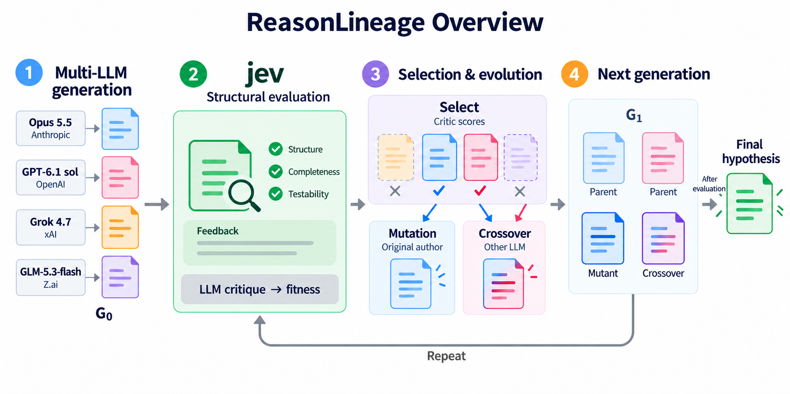

# ReasonLineage Overview — four-model configuration

내장 image_gen 도구로 기존 개요 그림을 수정했다. 요청된 모델명·회사명을 그대로 반영했다.

| Model | Provider |
|---|---|
| Opus 5.5 | Anthropic |
| GPT-6.1 sol | OpenAI |
| Grok 4.7 | xAI |
| GLM-5.3-flash | Z.ai |

## Suggested caption

Overview of the illustrated four-model ReasonLineage configuration. Opus 5.5 (Anthropic), GPT-6.1 sol (OpenAI), Grok 4.7 (xAI), and GLM-5.3-flash (Z.ai) each generate an initial hypothesis. Jev evaluates structural completeness and provides feedback, while LLM critics assign fitness scores. Two selected hypotheses serve as parents for mutation by the original author and crossover by another LLM. The retained parents and two offspring form the next generation. Evaluation, selection, and evolution repeat until termination, after which the highest-ranked evaluated hypothesis is returned. Colors indicate hypothesis lineages; the selected and rejected colors are schematic and do not represent an empirical ranking of the models.

## Scope

이 그림은 요청된 4모델 구성을 나타내는 도식이다. 초기 가설 4개, 생존 가설 2개, 변이 1개·교차 1개, 다음 세대 후보 4개를 표현한다. 기존 ALS·AML 16조건 실행은 Opus가 제외된 3모델 결과이며, 해당 실행 기록·사용량·평가 결과는 수정하지 않았다. 네 모델 모두를 사용한 실제 실험 결과로 이 도식을 인용하려면 그에 해당하는 실행 근거가 별도로 필요하다.

## Edit prompt

Use case: infographic-diagram edit.
Input image: edit target, the simplified ReasonLineage paper overview.
Primary request: Update this existing figure to show FOUR explicitly named LLMs and their providers, using the exact names supplied below. Keep the simplified four-stage publication layout, title, white background, restrained colors, central jev block, fitness strip, evolutionary logic, Repeat loop and terminal output. This is a four-model architecture overview, not an experimental-results plot. Do not add dataset names, run statistics, scores, claims that an experiment was completed, or footnotes.

Changes:
1. In stage 1 "Multi-LLM generation", replace the three generic chips "LLM A", "LLM B", "LLM C" with FOUR vertically arranged source chips. Each chip has exactly TWO lines, model name larger and bold, provider below it smaller. From top to bottom, render these names VERBATIM:
   "Opus 5.5"
   "Anthropic"

   "GPT-6.1 sol"
   "OpenAI"

   "Grok 4.7"
   "xAI"

   "GLM-5.3-flash"
   "Z.ai"

Do not substitute other names, do not add Claude to Opus, do not change "GPT-6.1 sol" to another spelling, do not change xAI capitalization, do not omit the dot in Z.ai. Require accurate legible typography.
2. Each of the FOUR model chips must point to its own hypothesis card. There are FOUR initial cards in G₀, one per model. Give the added fourth card its own subtle lineage color, distinct from the green jev block. Re-space the left-stage rows elegantly so all four model/provider pairs and their cards are readable and fit inside the existing wide canvas. It is acceptable to modestly increase canvas height if needed, but preserve ample white space.
3. In the "Select" subpanel of stage 3, represent FOUR incoming hypothesis cards instead of three: TWO retained parent cards with checks, TWO faded rejected cards with crosses. Retain the two existing parent lineage colors for mutation and crossover downstream. This is schematic selection, not a claim about real model performance. No scores or model labels on selected/rejected cards.
4. The next-generation pool stays at FOUR cards: two retained parents, one mutant, one crossover. Do not expand it to five or six. Mutation stays with "Original author"; crossover stays with "Other LLM".
5. Preserve all other labels EXACTLY, including "ReasonLineage Overview", "jev", "Structural evaluation", "Structure", "Completeness", "Testability", "Feedback", "LLM critique → fitness", "Selection & evolution", "Mutation", "Crossover", "Next generation", "Repeat", "Final hypothesis" and "After evaluation".

Accuracy constraints: Four models generate four initial hypotheses; two parents are selected; one mutation plus one crossover are added; subsequent generation size remains four. Jev is a STRUCTURAL evaluator, while LLM critiques supply fitness. Do not add jev as a fifth generator, do not depict provider companies as extra models, and do not remove the critic fitness strip. Preserve the correct parent/offspring arrows and the evaluation qualifier before final output.
Finish as a polished publication-ready English figure, with four readable model/provider pairs and no crowding.

