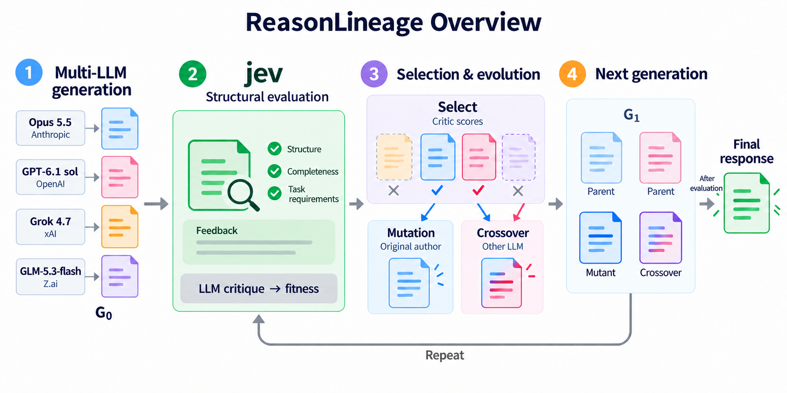

# ReasonLineage Overview — domain-general output

내장 image_gen으로 4모델 Overview의 두 용어를 수정했다.

## Changes

- Final hypothesis → Final response
- Testability → Task requirements

가설에 한정하지 않고 질문의 답변, 추론을 거친 해결안, 연구 제안을 포괄한다. 네 모델·회사명, jev 구조 평가와 LLM fitness의 구분, 선택·변이·교차·반복 흐름은 유지했다.

## Reference

사용자 제공 문서: /common/jungj2/project/ReasonLineage/.orca/drops/2026-10-09-reasonlineage-job-application.md. 문서의 3.1절 개체=답, 5절 분야를 가리지 않는 구조를 개념적 범위의 근거로 참고했다. 해당 원문은 수정하지 않았다. 문서의 과거 실험 수치는 이번 그림에 포함하지 않았다.

## Suggested caption

Domain-general overview of ReasonLineage. Multiple LLMs generate candidate responses to a task. Jev independently assesses structural completeness and task requirements and provides targeted feedback, while LLM critics supply fitness scores. Selected responses act as parents for mutation by their original authors and crossover by another model. Retained parents and offspring form subsequent generations. The evaluation–selection–evolution loop repeats until termination, when the highest-ranked evaluated response is returned. Candidate responses may represent answers, reasoning-based solutions, or scientific hypotheses. Internal fitness and task correctness are evaluated separately; lineage colors illustrate derivation rather than empirical model rankings.

## Scope

표시된 네 모델은 요청된 구성 도식이다. 기존 ALS·AML 16조건 실행은 Opus가 제외된 3모델 결과이며 이 그림 수정으로 실행 기록이나 과거 결과가 바뀌지는 않는다.

## Edit prompt

Use case: infographic-diagram edit.
Input image: edit target, the four-model ReasonLineage Overview.
Primary request: Make the method overview domain-general rather than hypothesis-specific. This engine evolves candidate responses to arbitrary tasks, including scientific proposals, climate questions and computational problems.

Make ONLY these exact in-image text changes:
1. Replace the terminal label "Final hypothesis" with "Final response". Keep the word Final and response perfectly spelled, legible and in the existing two-line arrangement.
2. In the jev structural-evaluation checklist replace "Testability" with "Task requirements". Keep the adjacent green check symbol and fit this short label cleanly without overlap. If needed use two lines just within this checklist label, not a smaller unreadable font.
Do not add example tasks, domain names, statistical findings, figures or new workflow stages.
Preserve EVERYTHING ELSE: title "ReasonLineage Overview"; four exact model/provider pairs Opus 5.5 / Anthropic, GPT-6.1 sol / OpenAI, Grok 4.7 / xAI, GLM-5.3-flash / Z.ai; one initial candidate per model; the green jev Structural evaluation block with Structure, Completeness, Feedback; the subordinate "LLM critique → fitness"; four incoming cards with two selected and two rejected; Mutation / Original author; Crossover / Other LLM; next generation of four cards; G₀/G₁; Repeat loop; After evaluation qualifier; all arrows, colors, white space, card shapes, and geometry.
Important: jev is the structural inspector, while critic fitness drives selection. Final response is a selected candidate response, not an assertion of verified correctness. The figure should not claim that internal score increases prove task success.
Keep this a sparse polished publication-ready English overview. Do not change typography or redesign the image beyond the two labels requested.

