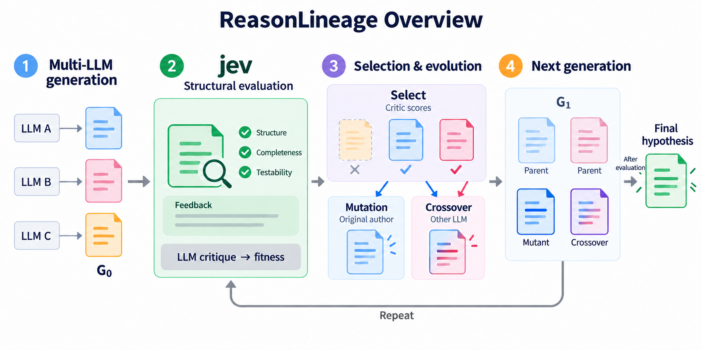

# ReasonLineage Overview

논문용으로 일반화한 개요 피규어. 내장 image_gen으로 생성·수정했다. 예제명·모델 버전·실험 수치를 생략했다.

## Suggested figure caption

Overview of ReasonLineage. Multiple LLMs generate an initial hypothesis pool. Jev evaluates structural completeness and provides targeted feedback, while LLM critics assign fitness scores. Selected hypotheses serve as parents for mutation by their original authors and crossover by another LLM. Retained parents and new offspring form the next generation. Evaluation, selection and evolution repeat until termination, when the highest-ranked evaluated hypothesis is returned.

## Meaning of the figure

LLM A/B/C는 교체 가능한 생성 모델을 나타낸다. 색상은 가설 계보를 표현하며 교차 카드의 두 색은 부모 아이디어의 결합을 나타낸다. jev는 구조 평가와 피드백을 담당한다. 현재 구현에서 생존자 선택용 fitness는 LLM 비판으로 계산하므로 그림의 작은 보조 표기로 구분했다.

## Prompt set

### reasonlineage-paper-overview-prompt.txt

Use case: infographic-diagram.
Asset type: a single publication-ready scientific paper OVERVIEW figure, high-resolution wide landscape, roughly 2:1, opaque white background.
Reference image: information reference ONLY. Completely redesign and simplify it. Do NOT preserve its dense boxes, long sentences, trial-specific labels, disease names, model names, exact statistics, thresholds, footnotes, comparison arms or color-heavy panels.
Primary request: An immediately understandable, elegant overview of ReasonLineage in which evolution of hypotheses across generations is visual, and jev is clearly the central evaluator of hypothesis STRUCTURE. The reader should understand the process within five seconds. Use short ENGLISH labels, large readable typography, thin precise arrows, lots of negative space, restrained flat graphics suitable for a research paper. No cartoon robots, no decorative illustrations, no vendor logos, no shadows or gradients.

Title, exactly: "ReasonLineage Overview"

Only FOUR large visual stages, flowing left to right, without enclosing them all in giant colored rectangles:
1. "Multi-LLM generation".
   Three small generic author chips labelled exactly "LLM A", "LLM B", "LLM C", each with one arrow to one colored hypothesis card. These three short cards form the first generation; label it "G₀". Use three subtle distinct lineage colors and sparse short line marks on each card, not paragraph text.
2. A visually prominent clean green evaluator block headed "jev" in noticeably large bold type.
   Under jev, label exactly "Structural evaluation".
   Use simple check symbols or an inspector lens around a hypothesis card. A small label "Feedback" may be included inside this block.
   IMPORTANT method accuracy: jev assesses structural completeness and gives feedback; scientific fitness used for selection is provided by LLM critics in the current method. Therefore include a small, clearly readable neutral-grey strip at the bottom of the evaluation area, labelled EXACTLY "LLM critique → fitness". This subordinate strip is enough; no separate giant critic panel. Do not suggest that jev computes the scientific fitness score or proves scientific truth.
3. "Selection & evolution".
   Show TWO retained parent cards at the top, labelled "Select" with the tiny short qualifier "Critic scores". Make one unselected initial lineage fade away to convey selection.
   Under the two selected parents, show two simple side-by-side branches:
   - "Mutation", with smaller label "Original author". ONE parent arrow leads to one modified descendant card. Use a visibly edited version of that parent's colored card.
   - "Crossover", with smaller label "Other LLM". TWO parent arrows converge on one new card with two parent-colored accents, visually showing combination.
   Use correct lineage arrows and very few words. No equations, scores, tables or engineering details.
4. "Next generation".
   Depict a clean group of FOUR small hypothesis cards: the two retained parents plus the two offspring. Give retained parents a subdued outline and new offspring a slightly stronger accent so survival and novelty are visible.
   A single clean feedback arc BELOW the four stages should go FROM the next-generation group BACK TO the jev evaluation area, not to initial generation. Label it only "Repeat". New hypotheses are evaluated; retained parents carry saved scores. Do not imply repeated recreation of the initial hypotheses.
   From the next-generation group, a short separate rightward exit can end at a single subtly highlighted card labelled "Final hypothesis". This is a terminal output of the loop, not a fifth full large stage. No direct arrow from jev to final output bypassing selection and evolution.

Visual priorities: hypothesis lineages and parent-to-offspring flow dominate. The green jev block is the central evaluation landmark. Mutation and crossover must be understandable from the arrow patterns alone. Label text is minimal and mostly 1–3 words. Keep all labels legible at paper column or slide scale. At least 35 percent calm white space. The diagram should look like an elegant vector-style scientific schematic even though it is a raster image.
Topology accuracy: generate initial candidates -> jev structural evaluation plus subordinate LLM critique/fitness -> select two -> mutate one and cross two -> retain parents plus offspring -> next-generation evaluation, repeat -> final hypothesis. Do not add a giant conditional rewrite loop or J1/J2 technical details; those belong in the Methods caption. Avoid disconnected feedback lines, ambiguous bidirectional arrows, crossed connectors through labels, duplicate stages or arrows ending at no node.

Do NOT include: ALS, AML, GPT, Grok, GLM, Opus, DeepSeek, numerical fitness values, actual experiment counts, zero-rewrite statistics, thresholds 0.5, Noul/Choice/Score taxonomy, J1/J2 names, on/off comparator, citations, full sentences, legend blocks or footnotes. This is a general METHOD Overview for a paper, not a report of the current case studies.

### reasonlineage-paper-overview-refinement-prompt.txt

Use case: infographic-diagram edit. Keep this simplified scientific-paper overview EXACTLY as it is: same elegant white layout, same title, same four stages, same model chips, same jev block, colors, arrows, parent cards, mutation, crossover, next-generation group, Repeat loop and final output. Change ONLY two tiny text details for method accuracy:
1. In the green jev structural evaluation checklist, replace the word "Consistency" with "Testability". Keep the first two labels "Structure" and "Completeness".
2. Above the short right-pointing arrow leading from Next generation to Final hypothesis, add the small readable qualifier "After evaluation". This means final selection happens only after candidates have been evaluated; there must be no implied ungraded final output.
Do not add any other text, stages, footnotes, panels, disease names or numerical experiment results. Preserve typography and geometry. This remains a sparse publication-ready English overview. Jev performs structural evaluation; the subordinate "LLM critique → fitness" strip must remain unchanged.

